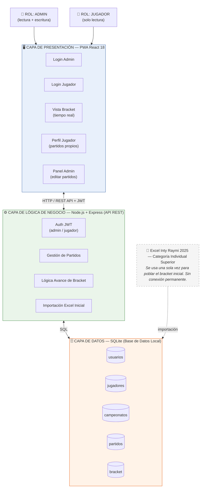
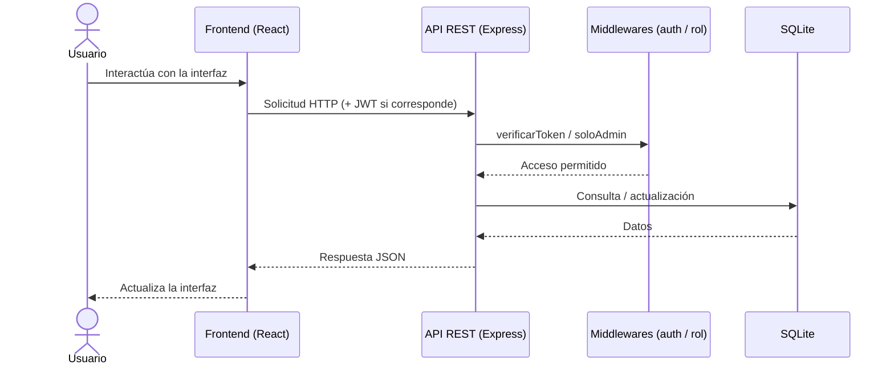
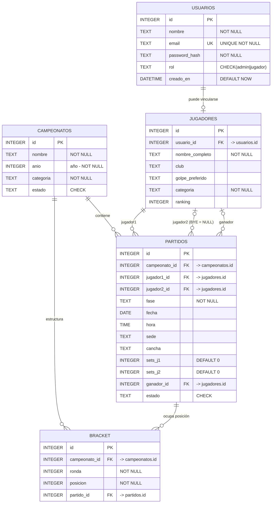
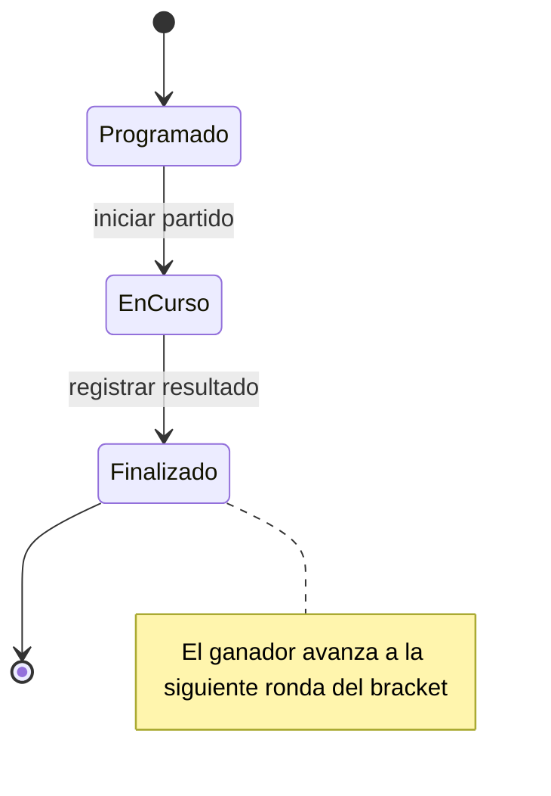
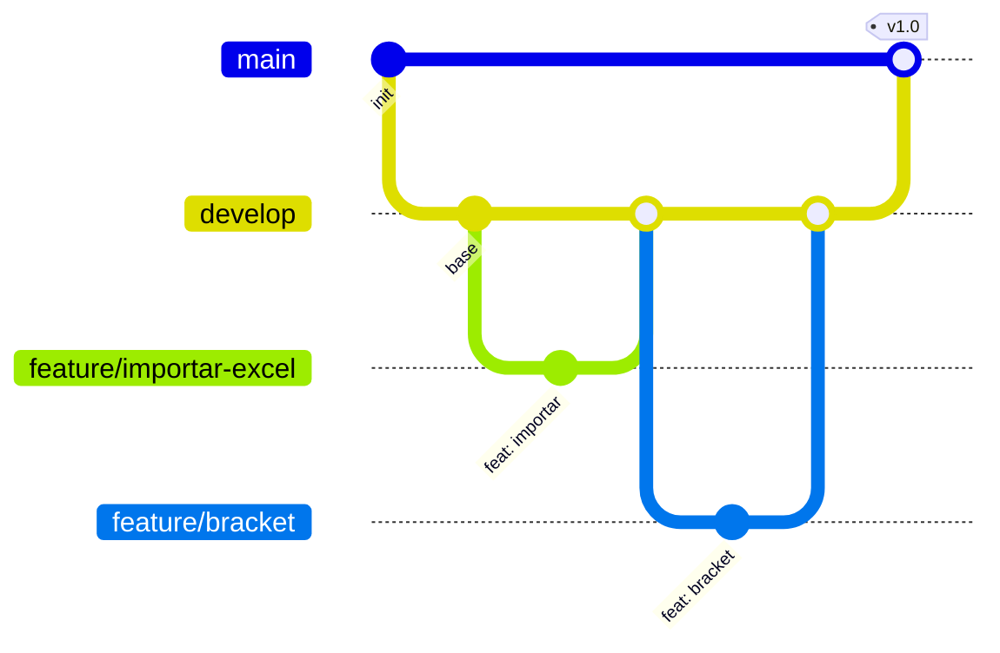

# FRONT-ON · Documentación Técnica

> **Aplicación web progresiva (PWA) para campeonatos de paleta frontón**
> Sistema de gestión de configuración y documentación del software


**Equipo de desarrollo**

| Integrante |
|---|
| Rodrigo Ojeda Arce |
| Arnold Daniel Saya Ramos |
| Joshua David Ortiz Rosas |
| Carlos Adrian Vizarreta Checya |


Escuela Profesional de Ingeniería de Software · Arequipa – Perú · 2026

---

## Control del documento

| Campo | Valor |
|---|---|
| **Nombre del sistema** | FRONT-ON |
| **Tipo de documento** | Documentación técnica del proyecto de software |
| **Versión del documento** | 1.0 |
| **Fuente** | Documento de investigación formativa proporcionado |
| **Repositorio de configuración** | Git / GitHub — <https://github.com/ArnoldSaya/Proyecto_Calidad_de_Software.git> |

---

## Contenido

1. [Descripción técnica del sistema](#1-descripción-técnica-del-sistema)
2. [Arquitectura del software](#2-arquitectura-del-software)
3. [Modelo de datos](#3-modelo-de-datos)
4. [Estructura del proyecto](#4-estructura-del-proyecto)
5. [Componentes del backend](#5-componentes-del-backend)
6. [Componentes del frontend](#6-componentes-del-frontend)
7. [Interfaces y operaciones principales](#7-interfaces-y-operaciones-principales)
8. [Seguridad](#8-seguridad)
9. [Configuración y control de versiones](#9-configuración-y-control-de-versiones)
10. [Plan de pruebas técnicas](#10-plan-de-pruebas-técnicas)
11. [Herramientas tecnológicas](#11-herramientas-tecnológicas)
- [Anexo A. Elementos que deben contrastarse con el repositorio](#anexo-a-elementos-que-deben-contrastarse-con-el-repositorio)

---

## 1. Descripción técnica del sistema

**FRONT-ON** es una aplicación web progresiva (PWA) orientada a consultar y administrar información de campeonatos de paleta frontón. La solución contempla perfiles diferenciados para **administradores** y **jugadores**, consulta de partidos y bracket, importación de información desde archivos Excel y visualización adaptada a dispositivos móviles.

El sistema se plantea con una arquitectura **cliente-servidor de tres capas**: presentación, lógica de negocio y persistencia. La comunicación entre frontend y backend se realiza mediante una **API REST**. Las tecnologías principales son **React 18**, **Node.js con Express** y **SQLite**.

### 1.1 Funciones técnicas principales

| # | Función | Descripción |
|---|---|---|
| F1 | Autenticación y autorización | Autenticación de usuarios y autorización según el rol (administrador o jugador). |
| F2 | Importación de campeonato | Importación de la plantilla Excel de un campeonato y creación de los registros correspondientes. |
| F3 | Gestión de partidos | Consulta y administración de partidos, programación, resultados y avance entre rondas. |
| F4 | Visualización del bracket | Bracket organizado por rondas y consulta de los partidos asociados al jugador autenticado. |
| F5 | Interfaz responsive | Interfaz adaptable a móviles y escritorio, con navegación específica para el jugador. |
| F6 | Capacidades PWA | Instalación y consulta de información almacenada en caché, contempladas en el diseño del proyecto. |

---

## 2. Arquitectura del software

La arquitectura separa las responsabilidades en tres capas para facilitar el mantenimiento y limitar el acoplamiento entre interfaz, lógica de negocio y datos.



**Detalles de cada capa (según el diagrama de arquitectura):**

| Capa | Tecnología | Elementos clave |
|---|---|---|
| Presentación | React 18 (PWA) | Service Workers · Web App Manifest · Modo Offline · Diseño Responsive Mobile-First · Instalable en Android e iOS · Meta Lighthouse PWA Score = 100 |
| Lógica de negocio | Node.js + Express | Rutas `/auth` · `/campeonatos` · `/partidos` · `/bracket` · `/jugadores` · `/import` · Autenticación JWT con 2 roles · Middleware de errores y logging |
| Datos | SQLite | Fuente única de verdad · Sin dependencias externas en producción |
| Fuente externa | Excel | Solo importación inicial |

### 2.1 Capa de presentación

Implementada con **React 18**. Contiene las vistas, componentes de navegación, formularios y tablas. Consume el backend mediante un cliente HTTP centralizado.

### 2.2 Capa de lógica de negocio

Implementada con **Node.js y Express**. Expone rutas REST, aplica reglas de acceso, procesa la importación del campeonato, gestiona partidos y calcula el avance del bracket.

### 2.3 Capa de datos

**SQLite** almacena la información de usuarios, jugadores, campeonatos, partidos y bracket. El módulo de acceso a datos centraliza las consultas utilizadas por las rutas del servidor.

### 2.4 Flujo general de comunicación



1. El usuario interactúa con la interfaz React.
2. El frontend envía una solicitud HTTP a la API REST e incorpora el token JWT cuando corresponde.
3. Express recibe la solicitud, ejecuta los middlewares de autenticación/autorización y la lógica de la ruta.
4. El backend consulta o actualiza la base de datos SQLite.
5. El servidor devuelve una respuesta HTTP en formato JSON y React actualiza la interfaz.

> **Resumen:** `Usuario → Frontend React → API REST (Node.js/Express) → SQLite`. Los endpoints protegidos requieren autenticación y aplican permisos según el rol.

---

## 3. Modelo de datos

El modelo SQLite tiene **cinco entidades principales**: Usuario, Jugador, Campeonato, Partido y Bracket. El diseño se basa en la información de las llaves del campeonato **TCN 500 Cusco Inty Raymi 2025**, categoría **Individual Varones Libre**.

### 3.1 Diagrama entidad-relación



### 3.2 Resumen de entidades

| Entidad | Responsabilidad | Relaciones o datos relevantes |
|---|---|---|
| **Usuario** | Cuenta y autenticación | Credenciales y rol de acceso. |
| **Jugador** | Datos del deportista | Nombre, ranking/categoría y datos deportivos; puede vincularse a una cuenta. |
| **Campeonato** | Datos generales del torneo | Nombre, año, categoría y sede. |
| **Partido** | Programación y resultado | Ronda, jugadores, fecha, hora, sede, cancha, estado y resultado por sets. |
| **Bracket** | Estructura y avance de la llave | Relación entre partidos y avance del ganador a la ronda siguiente. |

### 3.3 Diccionario de datos

<details>
<summary><b>usuarios</b></summary>

| Campo | Tipo | Restricción | Descripción |
|---|---|---|---|
| `id` | INTEGER | PK | Identificador del usuario |
| `nombre` | TEXT | NOT NULL | Nombre del usuario |
| `email` | TEXT | UNIQUE, NOT NULL | Correo de acceso |
| `password_hash` | TEXT | NOT NULL | Contraseña cifrada con bcrypt |
| `rol` | TEXT | CHECK (`admin` \| `jugador`) | Rol de acceso |
| `creado_en` | DATETIME | DEFAULT NOW | Fecha de creación |

</details>

<details>
<summary><b>jugadores</b></summary>

| Campo | Tipo | Restricción | Descripción |
|---|---|---|---|
| `id` | INTEGER | PK | Identificador del jugador |
| `usuario_id` | INTEGER | FK → `usuarios.id` (opcional) | Cuenta vinculada |
| `nombre_completo` | TEXT | NOT NULL | Nombre del deportista |
| `club` | TEXT | — | Club de procedencia |
| `golpe_preferido` | TEXT | — | Golpe preferido |
| `categoria` | TEXT | NOT NULL | Categoría competitiva |
| `ranking` | INTEGER | — | Posición en el ranking |

</details>

<details>
<summary><b>campeonatos</b></summary>

| Campo | Tipo | Restricción | Descripción |
|---|---|---|---|
| `id` | INTEGER | PK | Identificador del campeonato |
| `nombre` | TEXT | NOT NULL | Nombre del torneo |
| `año` | INTEGER | NOT NULL | Año del torneo |
| `categoria` | TEXT | NOT NULL | Categoría |
| `estado` | TEXT | CHECK | Estado del campeonato |

</details>

<details>
<summary><b>partidos</b></summary>

| Campo | Tipo | Restricción | Descripción |
|---|---|---|---|
| `id` | INTEGER | PK | Identificador del partido |
| `campeonato_id` | INTEGER | FK → `campeonatos.id` | Campeonato al que pertenece |
| `jugador1_id` | INTEGER | FK → `jugadores.id` | Primer jugador |
| `jugador2_id` | INTEGER | FK → `jugadores.id` (puede ser NULL en BYE) | Segundo jugador |
| `fase` | TEXT | NOT NULL | Ronda del partido |
| `fecha` | DATE | — | Fecha programada |
| `hora` | TIME | — | Hora programada |
| `sede` | TEXT | — | Sede |
| `cancha` | TEXT | — | Cancha |
| `sets_j1` | INTEGER | DEFAULT 0 | Sets ganados por jugador 1 |
| `sets_j2` | INTEGER | DEFAULT 0 | Sets ganados por jugador 2 |
| `ganador_id` | INTEGER | FK → `jugadores.id` (opcional) | Ganador del partido |
| `estado` | TEXT | CHECK | Programado / En curso / Finalizado |

</details>

<details>
<summary><b>bracket</b></summary>

| Campo | Tipo | Restricción | Descripción |
|---|---|---|---|
| `id` | INTEGER | PK | Identificador de la entrada |
| `campeonato_id` | INTEGER | FK → `campeonatos.id` | Campeonato |
| `ronda` | INTEGER | NOT NULL | Número de ronda |
| `posicion` | INTEGER | NOT NULL | Posición en la llave |
| `partido_id` | INTEGER | FK → `partidos.id` | Partido asociado |

</details>

### 3.4 Notas del modelo

- La relación de avance entre partidos contempla el campo **`partido_siguiente_id`**, mencionado en la descripción del diagrama de clases.
- La importación contempla partidos **BYE**: en esos casos `jugador2_id` puede quedar vacío hasta que corresponda completar el espacio.

> [!NOTE]
> **Nota de consistencia:** el documento original menciona en una sección un objetivo de seis tablas, pero la descripción del modelo implementado enumera cinco tablas principales. Esta documentación conserva la descripción de cinco entidades y deja constancia de la diferencia. Asimismo, `partido_siguiente_id` no aparece en el diagrama ER; debe verificarse en el código.

---

## 4. Estructura del proyecto

El proyecto se separa en **backend** y **frontend**:

```text
FRONT-ON/
├── backend/
│   ├── server.js
│   ├── database.js
│   ├── auth.js
│   └── routes/
│       ├── importar.routes.js
│       ├── partidos.routes.js
│       └── auth.routes.js
└── frontend/
    └── src/
        ├── api/axios.js
        ├── App.jsx
        └── components / views
            ├── Login.jsx
            ├── Partidos.jsx
            ├── Bracket.jsx
            └── NavbarJugador.jsx
```

> [!IMPORTANT]
> El árbol anterior es una representación lógica de los módulos documentados. Los nombres y rutas exactos de carpetas deben contrastarse con el repositorio Git vigente antes de usarse como inventario definitivo.

---

## 5. Componentes del backend

| Archivo | Rol | Responsabilidad |
|---|---|---|
| `server.js` | Punto de entrada | Inicializa Express, configura middleware (CORS) y registra las rutas de la API. |
| `database.js` | Acceso a datos | Centraliza el acceso a SQLite y las consultas usadas por las rutas. |
| `auth.js` | Control de acceso | Verifica el JWT y restringe operaciones administrativas por rol. |
| `routes/importar.routes.js` | Importación | Procesa el Excel del campeonato y crea registros. |
| `routes/partidos.routes.js` | Gestión de partidos | Consulta, estados, resultados y avance del bracket. |
| `routes/auth.routes.js` | Autenticación | Login, lista de jugadores sin cuenta y registro. |

### 5.1 `server.js` — punto de entrada

Inicializa Express, configura middleware como CORS y registra las rutas de la API. Es el punto de arranque del servidor.

### 5.2 `database.js` — acceso a datos

Centraliza el acceso a SQLite y las consultas utilizadas por los módulos de rutas.

### 5.3 `auth.js` — control de acceso

Verifica el token JWT enviado en el encabezado `Authorization`.

| Situación | Respuesta |
|---|---|
| Token ausente | `HTTP 401` |
| Token inválido o expirado | `HTTP 403` |
| Rol distinto de `admin` en ruta administrativa | Acceso denegado |

```http
Authorization: Bearer <token>
```

- **`verificarToken`**: valida la firma y vigencia del JWT.
- **`soloAdmin`**: permite continuar únicamente si el rol autenticado es `admin`.

### 5.4 `importar.routes.js` — importación de campeonato

Procesa el archivo Excel:

1. Obtiene los metadatos del torneo.
2. Registra el campeonato.
3. Filtra las filas que corresponden a rondas válidas.
4. Identifica jugadores únicos.
5. Crea partidos y entradas del bracket.

**Rondas reconocidas:** `64avos` · `32avos` · `16avos` · `octavos` · `cuartos` · `semifinal` · `final`.
Las filas decorativas o rondas no reconocidas se descartan.

### 5.5 `partidos.routes.js` — gestión de partidos

Agrupa operaciones de consulta y actualización de partidos, cambios de estado, registro de resultados y avance de los ganadores a la ronda siguiente. La lógica debe respetar el estado del partido y evitar que un **BYE** genere un avance incorrecto.



### 5.6 `auth.routes.js` — autenticación y registro

Incluye el inicio de sesión, la consulta de jugadores que todavía no tienen una cuenta y el registro que vincula una cuenta nueva con un jugador existente. El registro contempla datos deportivos como **club** y **golpe preferido**.

---

## 6. Componentes del frontend

| Archivo | Rol | Responsabilidad |
|---|---|---|
| `api/axios.js` | Cliente HTTP | URL base de la API e inyección automática del JWT. |
| `App.jsx` | Enrutamiento | Define rutas y protege vistas con `PrivateRoute`. |
| `Login.jsx` | Acceso y registro | Inicio de sesión y registro vinculado a jugador. |
| `Partidos.jsx` | Vista administrativa | Tabla filtrable, edición de programación y resultados. |
| `Bracket.jsx` | Visualización de llaves | Agrupa partidos por ronda y resalta los del jugador. |
| `NavbarJugador.jsx` | Navegación | Barra horizontal (escritorio) y barra inferior (móvil). |

### 6.1 `axios.js` — cliente HTTP

Centraliza la URL base de la API y agrega automáticamente el JWT almacenado en `localStorage` al encabezado `Authorization` de las solicitudes.

```javascript
const api = axios.create({
  baseURL: 'http://localhost:3000/api',
});

api.interceptors.request.use((config) => {
  const token = localStorage.getItem('token');
  if (token) config.headers.Authorization = `Bearer ${token}`;
  return config;
});
```

### 6.2 `App.jsx` — enrutamiento y protección

Define las rutas de la aplicación y utiliza un componente `PrivateRoute` para comprobar la presencia del token y el rol requerido antes de mostrar una vista protegida.

### 6.3 `Login.jsx` — acceso y registro

Permite el inicio de sesión. Para el registro de jugadores, consulta la lista de jugadores disponibles, vincula la cuenta y, tras registrarla correctamente, inicia sesión y dirige al usuario al panel correspondiente.

### 6.4 `Partidos.jsx` — vista administrativa

Presenta los partidos del campeonato en una tabla filtrable por ronda. Permite editar la programación, iniciar partidos programados y registrar resultados cuando el partido está en curso. El formulario de resultado admite **entre dos y cinco sets**.

### 6.5 `Bracket.jsx` — visualización de llaves

Agrupa los partidos por ronda en el orden competitivo establecido y permite identificar los partidos en los que participa el jugador autenticado.

### 6.6 `NavbarJugador.jsx` — navegación

Proporciona navegación horizontal en escritorio y una barra inferior para móviles. Incluye accesos a **Inicio**, **Mis partidos**, **Bracket** y **Perfil**.

---

## 7. Interfaces y operaciones principales

| Método | Ruta documentada | Uso | Acceso esperado |
|:---:|---|---|---|
| `POST` | `/api/auth/login` | Validar credenciales y emitir JWT | 🌐 Público |
| `GET` | `/api/auth/jugadores-lista` | Listar jugadores aún sin cuenta | 🌐 Público (según el documento) |
| `POST` | `/api/auth/registro` | Vincular una cuenta a un jugador | 📝 Registro |
| `POST` | `/api/importar` | Importar plantilla Excel del campeonato | 🔒 Administrador |
| `GET` | `/api/partidos` | Consultar partidos | 🔑 Usuario autenticado |
| `GET` | `/api/bracket` | Consultar bracket | 🔑 Usuario autenticado |
| `GET` | `/api/mis-partidos` | Consultar partidos del jugador autenticado | 🔑 Jugador autenticado |
| `PUT` | `/api/partidos/:id/resultado` | Registrar resultado y actualizar el bracket | 🔒 Administrador |

> [!WARNING]
> Las rutas y métodos de registro de resultados aparecen con variaciones en el documento original (por ejemplo, `PUT /api/resultado` y `PUT /api/partidos/:id/resultado`). Debe prevalecer la definición que figure en el código fuente del repositorio.

---

## 8. Seguridad

| Medida | Implementación |
|---|---|
| Autenticación | Tokens **JWT** |
| Contraseñas | Almacenadas como hash y verificadas con **bcrypt** |
| Autorización | Control de acceso basado en roles (`admin` / `jugador`) |
| Rutas protegidas | Rechazo de solicitudes sin token o con token inválido/alterado |
| Importación | Validación del tipo de archivo recibido |
| Secretos | Variable de entorno `JWT_SECRET`; los secretos **no** se guardan en el repositorio |

> El documento describe el almacenamiento del token en `localStorage` y el uso de un interceptor Axios. La implementación real debe revisarse para confirmar las medidas de seguridad configuradas en el entorno de despliegue.

---

## 9. Configuración y control de versiones

### 9.1 Gestión de configuración con Git

Se utiliza **Git y GitHub** como sistema de gestión de configuración del código fuente, con una estrategia de ramas `main`, `develop` y `feature/*`, y mensajes de commit consistentes.

### 9.2 Convención de ramas



| Rama | Propósito |
|---|---|
| `main` | Versión estable del proyecto. |
| `develop` | Integración de funcionalidades antes de incorporarlas a la versión estable. |
| `feature/nombre-funcionalidad` | Desarrollo aislado de una funcionalidad o corrección. |

### 9.3 Convención de commits

| Prefijo | Uso | Ejemplo |
|---|---|---|
| `feat:` | Agregar una funcionalidad | `feat: importar plantilla Excel` |
| `fix:` | Corregir un error | `fix: avance incorrecto con BYE` |
| `docs:` | Actualizar documentación | `docs: actualizar README técnico` |
| `test:` | Agregar o modificar pruebas | `test: casos de integración de login` |
| `refactor:` | Reorganizar código sin cambiar el comportamiento | `refactor: separar consultas de partidos` |

### 9.4 Variables y archivos sensibles

Las credenciales de JWT y de servicios externos deben mantenerse en variables de entorno y **no publicarse en Git**. Se recomienda mantener un archivo `.env.example` con los nombres de las variables requeridas y valores ficticios:

```env
# .env.example — valores ficticios, NO usar en producción
JWT_SECRET=cambia_este_valor
```

> El documento de investigación propone configurar el repositorio GitHub y CI básico, pero no proporciona evidencia verificable de la configuración vigente. Estos datos deben completarse con la información real del repositorio utilizado para la entrega.

---

## 10. Plan de pruebas técnicas

> [!NOTE]
> En varias fichas del documento original el campo «Resultado real» está pendiente, aunque el estado figure como «Completado». Por ello, se describen como **casos definidos en el plan**, no como resultados verificados de forma independiente.

### 10.1 Pruebas unitarias

| ID | Módulo | Verificación | Resultado esperado | Resultado real |
|---|---|---|---|---|
| PU-01 | JWT | Generación y verificación de token | Payload contiene `id` y `rol`; firma válida. | ⏳ Pendiente |
| PU-02 | Contraseñas | Comparación de hash bcrypt | La contraseña correcta coincide y la incorrecta no. | ⏳ Pendiente |
| PU-03 | Estados de partido | Transiciones de estado | Programado → En curso → Finalizado; transición inválida controlada. | ⏳ Pendiente |

### 10.2 Pruebas de integración

| ID | Caso | Resultado esperado | Resultado real |
|---|---|---|---|
| PI-01 | Inicio de sesión correcto | `HTTP 200` y JWT utilizable en rutas protegidas. | ⏳ Pendiente |
| PI-02 | Credenciales incorrectas | `HTTP 401` y sin token en la respuesta. | ⏳ Pendiente |
| PI-03 | Importación de Excel | Archivo procesado; campeonatos, jugadores y partidos registrados sin filas decorativas. | ⏳ Pendiente |
| PI-04 | Registro de resultado | Ganador asignado al espacio correcto de la siguiente ronda; BYE tratado correctamente. | ⏳ Pendiente |
| PI-05 | Partidos del jugador | La respuesta contiene solo partidos del jugador autenticado. | ⏳ Pendiente |

### 10.3 Pruebas de sistema (End-to-End)

| ID | Actor | Flujo | Resultado esperado |
|---|---|---|---|
| PS-01 | Administrador | Iniciar sesión → importar Excel → editar programación → registrar resultado | Bracket actualizado correctamente. |
| PS-02 | Jugador | Iniciar sesión → consultar sus partidos y el bracket | No dispone de opciones de edición. |

### 10.4 Pruebas de seguridad, rendimiento y compatibilidad

| ID | Tipo | Caso | Resultado esperado / meta |
|---|---|---|---|
| PC-SEG-01 | 🔐 Seguridad | Acceso a ruta protegida sin token | `HTTP 401` |
| PC-SEG-02 | 🔐 Seguridad | Ruta administrativa con token de jugador | Acceso denegado |
| PC-SEG-03 | 🔐 Seguridad | Token JWT con firma manipulada | Rechazo |
| PC-SEG-04 | 🔐 Seguridad | Importación de archivo que no es Excel | Rechazo |
| PC-REND-01 | ⚡ Rendimiento | Tiempo de importación del Excel | Promedio ≤ **3000 ms** |
| PC-REND-02 | ⚡ Rendimiento | Tiempo de carga inicial de la PWA | Medición registrada |
| PC-REND-03 | ⚡ Rendimiento | Tiempo entre registrar resultado y ver bracket actualizado | Medición registrada |
| PC-COMP-01 | 📱 Compatibilidad | Vistas y acciones en Android/Chrome, iOS/Safari y escritorio (Chrome, Firefox) | Funcionamiento correcto |

### 10.5 Herramientas para ejecutar pruebas

| Herramienta | Uso |
|---|---|
| **Postman** | Llamadas a la API y medición de tiempos. |
| **SQLite Viewer (VS Code)** | Inspección de los registros. |
| **Chrome / Firefox / Safari** | Pruebas según el dispositivo. |
| **jwt.io** | Inspección de tokens de prueba, sin exponer secretos reales. |

---

## 11. Herramientas tecnológicas

| Tecnología / herramienta | Categoría | Uso en el proyecto |
|---|---|---|
| React 18 | Frontend | Interfaz de usuario y componentes. |
| Node.js | Backend | Entorno de ejecución del servidor. |
| Express | Backend | Servidor HTTP y API REST. |
| SQLite | Datos | Persistencia local de datos relacionales. |
| Axios | Frontend | Comunicación HTTP entre frontend y backend. |
| JWT | Seguridad | Autenticación mediante tokens. |
| bcrypt | Seguridad | Hash y verificación de contraseñas. |
| Git / GitHub | Configuración | Control de versiones y gestión de configuración. |
| Postman | Pruebas | Pruebas de endpoints e integración. |
| SQLite Viewer | Pruebas | Inspección de la base de datos durante pruebas. |
| PWA / Service Worker | Frontend | Instalación y capacidades de caché/offline. |

---

## Anexo A. Elementos que deben contrastarse con el repositorio

Para que esta documentación coincida exactamente con el software entregado, revisar el código fuente y completar:

- [ ] URL real del repositorio GitHub y rama utilizada para la entrega.
- [ ] Árbol de carpetas y nombres exactos de los archivos del proyecto.
- [ ] Versiones reales de Node.js, npm, React y dependencias del backend.
- [ ] Nombre definitivo y método HTTP del endpoint que registra resultados.
- [ ] Scripts disponibles para instalar dependencias, iniciar el frontend/backend y ejecutar pruebas.
- [ ] Estado real de las pruebas: registrar evidencia y resultados medidos, no solo el estado declarado.
- [ ] Configuración real de despliegue, CI y variables de entorno, sin publicar secretos.

---

<p align="center"><i>Proyecto FRONT-ON · Escuela Profesional de Ingeniería de Software · Arequipa – Perú · 2026</i></p>
